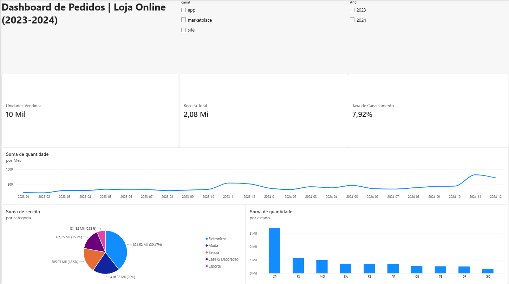

# Dashboard de Pedidos em Power BI

Dashboard em Power BI sobre os pedidos de uma loja online (jan/2023 a dez/2024). É o terceiro projeto da série: o [projeto 1](https://github.com/luizolavoremy/analise-pedidos-loja) fez a análise e a limpeza com pandas, o [projeto 2](https://github.com/luizolavoremy/analise-pedidos-loja-sql) refez as perguntas em SQL, e este junta os principais números num painel interativo.

> **Sobre este projeto:** é um projeto de estudo, feito com apoio de IA (Claude) como ferramenta de aprendizado. A base é **sintética**, gerada para estudo (detalhes no projeto 1), e os números não representam nenhuma empresa real.



**Base:** `pedidos_limpos.csv` com 4.871 pedidos e 14 colunas, já limpa no projeto 1.

## O que o dashboard mostra

| Visual | O que mostra |
|---|---|
| Cartão **Unidades vendidas** | Soma da quantidade vendida |
| Cartão **Receita total** | Soma da receita |
| Cartão **Taxa de cancelamento** | Percentual de pedidos cancelados |
| Gráfico de linhas | Unidades vendidas por mês |
| Gráfico de pizza | Participação de cada categoria na receita |
| Gráfico de colunas | Unidades vendidas por estado |
| Segmentações de dados | Filtros por canal e por ano, que atualizam a página inteira |

## Conferência com os projetos 1 e 2

Os números do dashboard foram conferidos contra os dos projetos anteriores:

| Verificação | Valor |
|---|---|
| Receita total | R$ 2.081.332,37 |
| Unidades vendidas | 9.665 (o cartão mostra "10 Mil" por causa do arredondamento) |
| Taxa de cancelamento | 7,92% |
| Mês de pico | nov/2024, com 825 unidades |
| Participação de Eletrônicos na receita | 39,47% |
| Unidades vendidas em SP | 3.405 |

## Medidas e colunas criadas (DAX)

| Item | Tipo | Fórmula |
|---|---|---|
| `Taxa de Cancelamento` | Medida | `DIVIDE(CALCULATE(COUNTROWS(pedidos_limpos), pedidos_limpos[status] = "Cancelado"), COUNTROWS(pedidos_limpos))` |
| `Mes` | Coluna calculada | `FORMAT(pedidos_limpos[data_pedido], "yyyy-MM")` |
| `Ano` | Coluna calculada | `FORMAT(pedidos_limpos[data_pedido], "yyyy")` |

## A mesma pergunta em três ferramentas

Como calcular a taxa de cancelamento:

| Ferramenta | Como |
|---|---|
| pandas | `(df["status"] == "Cancelado").sum() / df.shape[0]` |
| SQL | `100.0 * SUM(CASE WHEN status = 'Cancelado' THEN 1 ELSE 0 END) / COUNT(*)` |
| DAX (Power BI) | `DIVIDE(CALCULATE(COUNTROWS(...), status = "Cancelado"), COUNTROWS(...))` |

## Limitações

- O arquivo `.pbix` abre no **Power BI Desktop**, que é gratuito e roda só no Windows. O dashboard não foi publicado online.
- Os dados ficam dentro do `.pbix`. Para atualizar a partir do CSV em outro computador, é preciso ajustar o caminho da fonte em *Transformar dados > Configurações da fonte de dados*.
- Os cartões e gráficos mostram valores abreviados (Mil, Mi). O valor exato aparece ao passar o mouse ou em *Mostrar como uma tabela*.
- O dashboard cobre as perguntas principais. Os cruzamentos (produto por estado, por canal e por mês) ficaram nos projetos 1 e 2.
- A base é sintética.

## Tecnologias

Power BI Desktop · DAX · Git/GitHub

## Como abrir

1. Baixe ou clone este repositório.
2. Abra o arquivo `dashboard_pedidos.pbix` no Power BI Desktop.

## Estrutura do repositório

```
analise-pedidos-loja-powerbi/
├── dashboard_pedidos.pbix   # dashboard
├── pedidos_limpos.csv       # base já limpa no projeto 1
├── Imagens/
│   └── dashboard.png        # print usado neste README
└── README.md
```

## Próximos passos

- Uma página extra com a taxa de cancelamento por categoria e os cruzamentos de produto.

## Autor

Luiz Olavo Remy Firmino · https://www.linkedin.com/in/luiz-olavo-remy · luiz.olavo.remy@gmail.com
